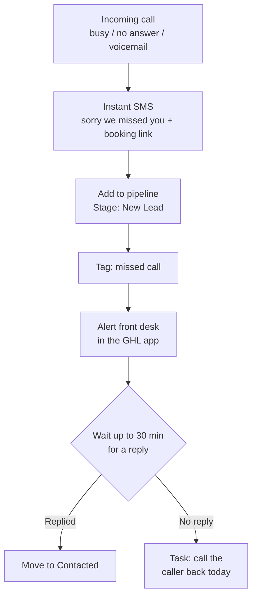

# GoHighLevel Missed Call Text-Back

A real GoHighLevel (GHL) workflow that texts every missed caller back **within seconds**, so a missed call doesn't turn into a lost customer.

Built in a GHL practice sub-account for a sample dental clinic, **BrightSmile Dental** (fictional business). It works the same for restaurants, spas, law firms, real estate teams and home services.

> **Why it matters:** most people who reach voicemail don't leave a message. They just call the next business on the list. An instant text keeps the conversation going while you're busy.

---

## How it works

## Workflow steps

| # | GHL action | Details |
|---|---|---|
| 1 | **Trigger: Call details** | Filters: call status is `busy`, `no-answer` or `voicemail`, and call direction is **Incoming** |
| 2 | **Send SMS** (instant) | "Sorry we missed your call" from Sara at the front desk, with a one-tap booking link |
| 3 | **Create / update opportunity** | Pipeline *New Patients - Speed to Lead*, stage **New Lead**, name `{{contact.phone}} - Missed call`, source *Missed phone call* |
| 4 | **Add tag** | `missed call` |
| 5 | **Internal notification** | In-app alert to all users: *Missed call from {{contact.phone}} - text-back sent*, opens the conversation |
| 6 | **Wait for reply** (up to 30 min) | Reply → step 7 · Timeout → step 8 |
| 7 | **Move opportunity** | Stage **Contacted** |
| 8 | **Add task** | *Call back missed caller*, due today (skips weekends), phone number in the description |

## The messages

**Instant SMS to the caller**

> Hi, sorry we missed your call at BrightSmile Dental! This is Sara from the front desk. How can we help? Just reply to this text, or book a visit any time here: *[booking link]* Reply STOP to opt out.

**In-app alert to the team**

> A caller couldn't get through, so they were texted straight away with a booking link. Check Conversations for their reply. If they don't reply within 30 minutes, a call-back task will be created.

**Staff task**

> This caller couldn't get through and hasn't replied to the text-back after 30 minutes. Please call them back today and offer to book a visit. Phone: {{contact.phone}}

> The SMS doesn't use the caller's first name on purpose: missed callers are often new contacts with only a phone number.

## Build it in your own GHL account

1. Make sure your sub-account has a GHL phone number that receives calls.
2. Automation → Workflows → **Create workflow** → start from scratch.
3. Add the **Call details** trigger and set the two filters above.
4. Add the actions in the order shown, swapping in your business name and booking link.
5. Test by calling your GHL number and letting it ring out, then **Publish**.

## Ideas to extend it

- Hand replies to **Conversation AI** so it can answer questions and book the slot
- Only send during business hours, with a different after-hours message
- Add a WhatsApp message alongside the SMS
- Feed it into the [speed-to-lead workflow](https://github.com/Kaynat-Umar/ghl-speed-to-lead-workflow) for multi-day follow-up

---

**Built by Kaynat Umar**, AI automation & GoHighLevel specialist.
Want this running in your GHL account? Message me on [LinkedIn](https://www.linkedin.com/in/kaynat-umar-51960a427) or email kaynatumar@gmail.com.
